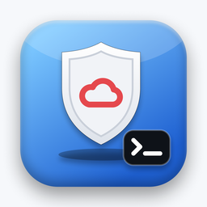

<p align="center"></p>

# oci-free-keeper

[](https://github.com/deeplabua/oci-free-keeper/actions/workflows/ci.yml)
[](https://crates.io/crates/oci-free-keeper)
[](LICENSE)
[](https://github.com/deeplabua/oci-free-keeper/stargazers)

**Keep your Oracle Cloud instance.** After a long hunt for a free ARM instance, know the moment it is
stopped or gone — on any account, pay-as-you-go included — and how close it is to Oracle's idle rule.

One binary, no OCI CLI, no Python. `check` reads 7 days of metrics for every instance in your home
region and compares them with the idle rule; `watch` looks every hour and notifies you when something
changes. **Read-only: it changes nothing in your account.**

Part of [DeepLab](https://deeplab.tools) — small, sharp tools that run locally. A sibling of
[oci-arm-catcher](https://github.com/deeplabua/oci-arm-catcher) (catch a free ARM instance) and
[oci-free-audit](https://github.com/deeplabua/oci-free-audit) (make sure it stays free). Built on
[oci-request-signer](https://github.com/deeplabua/oci-request-signer).


<sub>Recorded against a local mock of the OCI API (`assets/demo/`); the instances are made up.</sub>

## The rule

Oracle [may reclaim](https://docs.oracle.com/iaas/Content/FreeTier/resourceref.htm) an Always Free
instance if, over 7 days, **all** of these are below 20%:

- CPU, 95th percentile;
- network;
- memory — A1 only.

**One metric above 20% is enough.** An A1 with 12 GB that keeps 2.5 GB in use is safe even with
the CPU at zero. Burning CPU to look busy (NeverIdle, LookBusy) is not needed if something useful
already holds memory or traffic — keeper tells you which metric is protecting each instance.

| Verdict | Means |
|---|---|
| ✓ Safe | at least one metric above the warning line (25% by default) |
| ⚠ Close | every metric under 25%, at least one at 20% or more |
| ✗ At risk | every metric under 20%: idle by Oracle's rule |
| ✗ Stopped | not running |
| ? Unknown | no metrics — the Oracle Cloud Agent "Compute Instance Monitoring" plugin is off, or the instance is new |
| — Not subject | not an Always Free shape; the rule does not apply |

How the numbers are computed: CPU is the 95th percentile of 5-minute means over 7 days; memory and
network are 7-day means (lower than a 95th percentile, so keeper warns earlier rather than later).
Oracle does not say what "20% network" is measured against; keeper uses the shape's bandwidth —
1 Gbit/s per OCPU on A1, 50 Mbit/s on E2.1.Micro — and shows the raw bit/s in `--json`.

**Pay-as-you-go accounts.** The rule is written for Always Free accounts. On a PAYG tenancy we
watched, an "idle" A1 has not been reclaimed in five months. keeper still shows the verdict and
adds a note on PAYG accounts.

## Install

One self-contained binary for macOS, Linux and Windows. It talks to the OCI API directly —
**no OCI CLI and no Python needed**. Pick one:

**macOS / Linux — Homebrew**

```bash
brew install deeplabua/tap/oci-free-keeper
```

**macOS / Linux — installer script**

```bash
curl --proto '=https' --tlsv1.2 -LsSf https://github.com/deeplabua/oci-free-keeper/releases/latest/download/oci-free-keeper-installer.sh | sh
```

**Windows — PowerShell**

```powershell
powershell -c "irm https://github.com/deeplabua/oci-free-keeper/releases/latest/download/oci-free-keeper-installer.ps1 | iex"
```

**Any platform — from source** (needs [Rust](https://rustup.rs))

```bash
cargo install oci-free-keeper
```

Or download an archive for your platform from
[Releases](https://github.com/deeplabua/oci-free-keeper/releases).

It uses the API key in `~/.oci/config` — the same one the OCI CLI and
[oci-arm-catcher](https://github.com/deeplabua/oci-arm-catcher) use.

**Updating.** Run the same install command again, or
`brew upgrade deeplabua/tap/oci-free-keeper`. You don't have to watch for releases: at most once a
day the binary asks GitHub for the latest version and, if there is a newer one, prints a short
notice with the command to run (on stderr, so `--json` stays clean). It's off in CI and when stderr isn't a terminal; set
`OCI_FREE_KEEPER_NO_UPDATE_CHECK=1` to turn it off entirely.

## Use

The report (same as `oci-free-keeper check`):

```sh
oci-free-keeper
```

As JSON, for scripts and cron:

```sh
oci-free-keeper --json
```

A wider safety margin than the default 25%:

```sh
oci-free-keeper --warn-threshold 30
```

Only instances whose name or OCID contains `arm`:

```sh
oci-free-keeper --instance arm
```

Another profile in `~/.oci/config`:

```sh
oci-free-keeper --profile OTHER
```

Exit codes: `0` all safe, `1` close or unknown, `2` at risk or stopped, `3` could not run. Run it
daily from cron and alert on `2`.

## Watch

`watch` looks every hour and tells you only when something changes:

- ✗ an instance is **gone** — terminated, reclaimed or deleted. If its boot volume is still there,
  keeper says so and how to create a new instance from it;
- ✗ an instance **stopped**, and when it is running again;
- the idle verdict changed — Safe → Close → At risk and back.

Nothing is repeated: the last look is kept in your cache folder, so one change is one notification.
Notifications go to the desktop (macOS, Linux, Windows) and, if you give a URL, to a webhook — ntfy,
Slack, Discord, Telegram (`sendMessage`), or anything that takes JSON `{"text": "..."}`.

Run it in a terminal:

```sh
oci-free-keeper watch
```

Send notifications to your phone through [ntfy](https://ntfy.sh) as well:

```sh
oci-free-keeper watch --webhook https://ntfy.sh/your-secret-topic
```

On a server, look once an hour from cron — `--once` compares with the last look and exits
(`0` nothing urgent, `2` an instance is gone, stopped or newly at risk):

```sh
crontab -e
```

```
0 * * * * /usr/local/bin/oci-free-keeper watch --once --no-desktop --webhook https://ntfy.sh/your-secret-topic
```

<details><summary>systemd (Linux) and launchd (macOS)</summary>

`~/.config/systemd/user/oci-free-keeper.service`:

```ini
[Unit]
Description=oci-free-keeper watch

[Service]
ExecStart=%h/.cargo/bin/oci-free-keeper watch --no-desktop --webhook https://ntfy.sh/your-secret-topic
Restart=on-failure

[Install]
WantedBy=default.target
```

```sh
systemctl --user enable --now oci-free-keeper
```

`~/Library/LaunchAgents/tools.deeplab.oci-free-keeper.plist`:

```xml
<?xml version="1.0" encoding="UTF-8"?>
<!DOCTYPE plist PUBLIC "-//Apple//DTD PLIST 1.0//EN" "http://www.apple.com/DTDs/PropertyList-1.0.dtd">
<plist version="1.0"><dict>
  <key>Label</key><string>tools.deeplab.oci-free-keeper</string>
  <key>ProgramArguments</key><array>
    <string>/opt/homebrew/bin/oci-free-keeper</string><string>watch</string><string>--once</string>
  </array>
  <key>StartInterval</key><integer>3600</integer>
  <key>RunAtLoad</key><true/>
</dict></plist>
```

```sh
launchctl load ~/Library/LaunchAgents/tools.deeplab.oci-free-keeper.plist
```

</details>

## Permissions

Read-only. Checked on a real tenancy on 10 November 2026:

```
Allow group <your-group> to inspect compartments in tenancy
Allow group <your-group> to read instances in tenancy
Allow group <your-group> to read metrics in tenancy
```

`inspect instances` also works, but OCI then hides instance names; keeper shows the end of the
OCID instead. The PAYG note needs the Organizations API (`inspect all-resources` covers it). For
`watch` to find a gone instance's boot volume, add `Allow group <your-group> to inspect volumes in tenancy`.

## Not yet

Boot-volume backups within the 5 free, and `--auto-start` for a stopped instance. See [`CHANGELOG.md`](CHANGELOG.md).

## Support

If `oci-free-keeper` helped you keep your instance, two things help a lot:

- ⭐ **[Star the repo](https://github.com/deeplabua/oci-free-keeper)** — it's how other people holding on to a free instance find it.
- ☕ **[Buy me a coffee](https://send.monobank.ua/jar/4Hq7auheaa)** — if it saved you some time and you feel like it.

Both are completely optional. The tool is free and always will be.

## License

[MIT](LICENSE)
